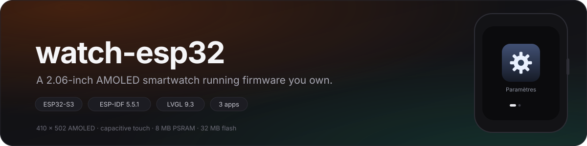
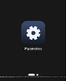

<div align="center">
  
</div>

<p align="center">
  <b>Firmware maison pour la Waveshare ESP32-S3-Touch-AMOLED-2.06.</b><br>
  Un lanceur, une app Paramètres de sept pages, un assistant vocal, une boîte à<br>
  musique générative et un labyrinthe à bille — sur une montre AMOLED 410 × 502.
</p>

<p align="center">
  <a href="https://github.com/withinaz/watch-esp32/releases"></a>
  <a href="https://github.com/withinaz/watch-esp32/actions/workflows/verify.yml"></a>
  
  
  
</p>

<p align="center"><sub><a href="README.md">English</a> · <b>Français</b></sub></p>

<table align="center">
  <tr>
    <td align="center" valign="middle"><br><sub>page 1 — Paramètres</sub></td>
    <td align="center" valign="middle"><br><sub>page 2 — Assistant</sub></td>
    <td align="center" valign="middle"><br><sub>page 3 — Musique</sub></td>
    <td align="center" valign="middle"><br><sub>page 4 — Perplexe</sub></td>
  </tr>
</table>

<p align="center"><sub>Captures réelles du tampon d'affichage de la montre. Une application par page, chacune<br>avec son icône 150 × 150 dessinée au pixel près à la compilation — aucun asset, aucun coût au runtime.</sub></p>

---

## Pourquoi ce dépôt

La montre est livrée avec un firmware fermé. Ce dépôt propose l'autre chemin :
un projet ESP-IDF complet et recompilable pour le même matériel, où chaque
pixel et chaque décision sont lisibles — et où les échecs sont documentés avec
autant de soin que les fonctionnalités.

Ce n'est pas une démonstration : le firmware démarre, se connecte au WiFi,
règle son heure par NTP, lit sa propre batterie et fait tourner quatre
applications, dont un assistant vocal qui parle à un vrai serveur, un moteur
musical qui compose pendant qu'il joue, et un labyrinthe qu'on pilote en
inclinant la montre.

**Tout ce qui est écrit ici a été mesuré sur la carte.** Chaque valeur de la
documentation (une largeur en pixels, un budget mémoire, un tempo) vient d'un
relevé instrumenté, jamais d'une estimation. Et ce qui ne marche pas encore est
dit sans détour.

## Ce qui fonctionne

| | Fonction | Détail |
|---|---|---|
| ✅ | AMOLED 410 × 502 | CO5300 en QSPI, luminosité 10–100, coins arrondis gérés |
| ✅ | Tactile | FT3168 — dans le lanceur et dans l'app Paramètres |
| ✅ | Une app par page | Le lanceur crée une page de plus à chaque app installée |
| ✅ | Icônes personnalisées | 150 × 150 ARGB8888, générées par `tools/make_icons.py` |
| ✅ | Barre d'état | orange, heure + date, batterie (AXP2101), WiFi (RSSI) |
| ✅ | WiFi | connexion auto depuis la NVS, scan et mot de passe dans l'app |
| ✅ | Heure | RTC PCF85063 + NTP, `Europe/Paris`, heure d'été gérée |
| ✅ | Batterie | registre `0xA4` de l'AXP2101 |
| ✅ | Son | codec ES8311 + ampli NS4150B, volume et bip de test |
| ✅ | Centrale inertielle | QMI8658, page « Capteurs » en temps réel |
| ✅ | Carte microSD | montage FAT, espace libre et nombre d'éléments |
| ✅ | Assistant vocal | protocole XiaoZhi : appairage OTA, WebSocket, Opus 24 kHz |
| ✅ | Musique générative | séquenceur pentatonique, synthèse de corde pincée, sans réseau |
| ✅ | Labyrinthe | Perplexe : dix niveaux générés sur 19 × 17 cases, pilotés par la centrale inertielle |
| ⚠️ | Tactile dans les apps | fonctionne dans le lanceur, Paramètres et Perplexe ; inopérant dans Assistant |

## Flasher en une minute

Une image vérifiée est versionnée dans [`firmware/`](firmware/). Aucune chaîne
de compilation nécessaire :

```powershell
git clone https://github.com/withinaz/watch-esp32
cd watch-esp32\firmware
.\flash.ps1
```

`flash.ps1` vérifie le SHA-256 de chaque image contre `SHA256SUMS` **avant**
d'ouvrir le port, écrit l'application en `0x200000` et ne touche pas à la
partition `nvs` : les identifiants WiFi de la montre survivent. Options :
`-Full` (bootloader + table de partitions + application), `-DryRun` (vérifier
sans écrire), `-Port COM7` si la carte n'est pas détectée.

```
  montre.bin              3 589 296 bytes  @ 0x200000 sha256 51ca2508dba666b3...
```

Équivalent manuel :

```powershell
python -m esptool --chip esp32s3 -p COM4 -b 921600 --before default_reset `
  --after hard_reset write_flash 0x200000 v4.0\montre.bin
```

Journal de démarrage attendu :

```
MONTRE: === montre : demarrage ===
MONTRE: ecran 410x502 pret
Brookesia: Library version: 0.5.0
Brookesia: (addIcon): All table pages are full, create a new page
MONTRE: === montre : interface prete ===
MONTRE: WiFi : connecte, IP ...
MONTRE: NTP : heure synchronisee -> ...
```

## Compiler depuis les sources

Il faut **ESP-IDF 5.5.1**, Python 3.11 (celui de l'IDF convient) et un câble
USB. Le premier build télécharge les dépendances déclarées dans
`dependencies.lock`.

```powershell
$env:IDF_PATH = 'C:\Espressif\frameworks\esp-idf-v5.5.1'
& "$env:IDF_PATH\export.ps1"

cd watch-esp32
idf.py build           # -> build/montre.bin, 3 589 296 octets
idf.py -p COM4 -b 921600 flash monitor
```

Ne **jamais** lancer `idf.py set-target` sur un projet existant : cela
régénère `sdkconfig` et perd les réglages de la carte (PSRAM octal à 80 MHz,
flash 32 Mo, jeu de polices LVGL). La cible est déjà `esp32s3`.

## Les quatre applications

**Paramètres** — sept pages : WiFi (scan, RSSI, saisie du mot de passe),
Affichage, Son, Horloge, Capteurs, Stockage, Appareil. Toutes les valeurs sont
lues sur le matériel ; rien n'est simulé, et rien n'est stocké en flash hormis
les identifiants WiFi, dans la `nvs`.

**Assistant** — le protocole XiaoZhi réimplémenté côté appareil : appairage OTA
par code à 6 chiffres, transport WebSocket, trames Opus de 60 ms à 24 kHz,
micro ES7210 à 37,5 dB + gain logiciel ×2, lecture par l'ES8311 à 90 %. Le
serveur fait STT → LLM → TTS ; **aucune clé d'API ne vit sur la montre**, elle
se configure dans la console. L'app se reconnecte seule toutes les 8 s et son
animateur de niveau suit les crêtes réelles du PCM, pas une animation.

**Musique** — sans réseau ni interaction : elle joue dès que la page s'ouvre.
Séquenceur pentatonique sur un cycle I–V–vi–IV, 78 à 96 BPM, dérive de tonalité
et de tempo toutes les quatre mesures, douze voix de corde pincée à 24 kHz
construites sur une table de sinus de 1024 points. L'interface est un piano
roll 12 × 10 alimenté par douze masques de bits écrits par la tâche audio :
aucun mutex, aucune allocation, seules les cases qui changent sont redessinées.

**Perplexe** — un labyrinthe vu de dessus, 19 × 17 cases, dix niveaux générés
par `tools/make_levels.py` et vérifiés par parcours en largeur : le but est
toujours atteignable sans traverser un trou. La bille est poussée par
l'accéléromètre, freinée par un doigt posé sur le plateau, renvoyée au dernier
point de passage par une secousse. 100 points par niveau, −10 par chute,
plancher 20 — et rien d'écrit en flash, la `nvs` garde les identifiants WiFi.

La physique tourne à 40 ms avec quatre sous-pas et une collision axe par axe :
la bille glisse le long des murs au lieu de s'y coller. Seuls l'ancien et le
nouveau rectangle de la bille sont repeints, et les murs sont fusionnés en
segments horizontaux — une quatre-vingtaine d'objets, pas 300.

## Les 25 pièges déjà payés

La plupart des projets embarqués documentent ce qui marche. Celui-ci documente
aussi ce qui a coûté des journées : le pool LVGL qui ignorait silencieusement
`LV_MEM_CUSTOM` et dessinait des bandes, le bus PSRAM qui affamait le DMA de
l'écran, la barre d'état qui figeait à jamais les 50 premières lignes, l'horloge
qui se masquait définitivement parce qu'un texte provisoire mesurait 150 px au
mauvais moment.

→ **[`docs/pitfalls.md`](docs/pitfalls.md)** — pour chacun : le symptôme, la
mesure qui l'a identifié, et le correctif.

## Documentation

| Document | Contenu |
|---|---|
| [`docs/architecture.md`](docs/architecture.md) | séquence de démarrage, tâches, carte mémoire, choix de la pile |
| [`docs/build.md`](docs/build.md) | chaîne de compilation, build, taille, rôle des clés `sdkconfig` |
| [`docs/flash.md`](docs/flash.md) | partitions, mise à jour de l'app seule, retour à l'usine |
| [`docs/board.md`](docs/board.md) | brochage, adresses I2C, écran et audio, découpage du flash |
| [`docs/interface.md`](docs/interface.md) | constantes d'interface figées, charte des icônes, liste des patchs |
| [`docs/adding-an-app.md`](docs/adding-an-app.md) | ajouter une quatrième app : classe, icône, enregistrement, le piège des 452 px |
| [`docs/assistant.md`](docs/assistant.md) | protocole XiaoZhi, chaîne audio, serveur perroquet, modes d'échec |
| [`docs/diagnostics.md`](docs/diagnostics.md) | capture série, captures d'écran, compteur par ligne, options d'autotest |
| [`docs/versions.md`](docs/versions.md) | ce que chaque version a changé, y compris les abandonnées |
| [`docs/versioning.md`](docs/versioning.md) | politique de version, liste de publication, étiquetage |
| [`docs/auto-publish.md`](docs/auto-publish.md) | comment la session de developpement est repliquee ici automatiquement |
| [`ROADMAP.md`](ROADMAP.md) | la suite |

## Limites connues

Liste honnête, à jour en v4.0 :

- **Le tactile ne répond pas dans l'app Assistant**, et seulement là : le
  lanceur, Paramètres et Perplexe reçoivent le doigt. Le défaut est donc dans
  cette application, pas dans le routeur d'événements. Elle n'a **aucun bouton
  retour** : on en sort en redémarrant la montre (RST). Trouver la cause reste
  le premier point de la feuille de route.
- **2 ou 3 lignes de pixels peuvent rester tout en haut** quand une app est
  ouverte avec un vrai doigt. Trois correctifs n'y ont rien changé et le défaut
  n'a jamais été reproduit hors de la montre, parce que les tests automatisés
  ouvrent les apps par programme et ne passent jamais par le chemin
  `LV_EVENT_PRESSED` qui agrandit une icône. Consigné avec ses mesures au
  [piège 21](docs/pitfalls.md#21-count-writes-per-row-not-pixels).
- **L'assistant a besoin d'un serveur.** Il parle à `xiaozhi.me` ; sans compte,
  l'app reste en « Hors ligne » (et retente toutes les 8 s).
- **Pas de mise à jour OTA.** L'application s'écrit en USB, en `0x200000`.
- **Interface en français**, code et documentation en anglais.
- **Une seule carte testée.** Le BSP est spécifique ; le brochage de
  `docs/board.md` est ce qu'il faudrait changer pour un autre écran.

## Versionnage

`MAJEUR.MINEUR.CORRECTIF`, avec une règle propre au projet : le **MAJEUR
n'augmente qu'à l'ajout d'une application** au lanceur. La v4.0 est la
quatrième génération (Paramètres, Assistant, Musique, Perplexe) ; les cinq
révisions de v3.0 à v3.5 étaient de la finition, pas des fonctionnalités.
Chaque incrément est étiqueté, décrit dans [`CHANGELOG.md`](CHANGELOG.md) et
livré avec un binaire vérifié — voir [`docs/versioning.md`](docs/versioning.md).

## Crédits et licence

Sur les épaules de : [ESP-IDF](https://github.com/espressif/esp-idf) et
[LVGL](https://lvgl.io) · [esp-brookesia](https://github.com/espressif/esp-brookesia)
(le shell, copié localement et patché) · [BSP Waveshare](https://github.com/waveshareteam/Waveshare-ESP32-components)
· le projet [xiaozhi-esp32](https://github.com/78/xiaozhi-esp32), dont ce
firmware parle le protocole · [libopus](https://opus-codec.org) via `78/esp-opus`.

Le code applicatif, les icônes, les outils et la documentation de ce dépôt sont
un travail original. Licence [Apache-2.0](LICENSE) ; le composant
`components/esp_brookesia` conserve sa propre licence Apache-2.0, voir
[NOTICE](NOTICE).
