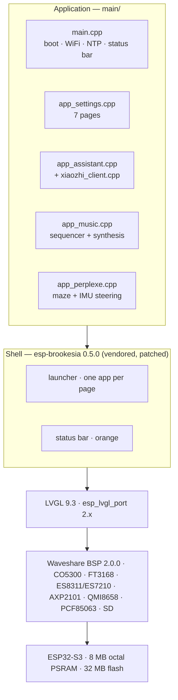

<div align="center">
  
</div>

<p align="center">
  <b>Custom firmware for the Waveshare ESP32-S3-Touch-AMOLED-2.06.</b><br>
  A launcher, a seven-page settings app, a voice assistant, a generative music box<br>
  and a marble maze — on a 410 × 502 AMOLED wristwatch, written from scratch.
</p>

<p align="center">
  <a href="https://github.com/withinaz/watch-esp32/releases"></a>
  <a href="https://github.com/withinaz/watch-esp32/actions/workflows/verify.yml"></a>
  
  
  
  
  
</p>

<p align="center"><sub><b>English</b> · <a href="README.fr.md">Français</a></sub></p>

<table align="center">
  <tr>
    <td align="center" valign="middle"><br><sub>page 1 — Paramètres</sub></td>
    <td align="center" valign="middle"><br><sub>page 2 — Assistant</sub></td>
    <td align="center" valign="middle"><br><sub>page 3 — Musique</sub></td>
    <td align="center" valign="middle"><br><sub>page 4 — Perplexe</sub></td>
  </tr>
</table>

<p align="center"><sub>Real framebuffer dumps from the watch. One app per page, each with a 150 × 150 icon<br>drawn pixel by pixel at build time — no image assets, no runtime cost.</sub></p>

---

## Why this exists

The watch ships with a closed firmware. This repository is the other path: a
complete, buildable ESP-IDF project for the same hardware, where every pixel
and every decision is readable, and where the failures are documented as
carefully as the features.

It is not a demo. It boots, connects to WiFi, sets its clock over NTP, reads
its own battery, and runs four applications — including a voice assistant
that talks to a real server, a music engine that composes as it plays, and a
maze you steer by tilting the watch itself.

**Everything here was measured on the board.** Where a number appears in the
documentation (a pixel width, a memory budget, a tempo), it came from an
instrumented run, not from an estimate — and where something is still broken,
it says so plainly.

## What works

| | Feature | Notes |
|---|---|---|
| ✅ | 410 × 502 AMOLED | CO5300 over QSPI, brightness 10–100, rounded corners handled |
| ✅ | Capacitive touch | FT3168 — launcher, Settings and Perplexe |
| ✅ | One app per page | The launcher grows a page per installed app, automatically |
| ✅ | Custom icons | 150 × 150 ARGB8888, generated by `tools/make_icons.py` |
| ✅ | Status bar | Orange, clock + date, battery (AXP2101), WiFi bars from RSSI |
| ✅ | WiFi | Auto-connect from NVS; scan and password entry in Settings |
| ✅ | Clock | PCF85063 RTC + NTP, `Europe/Paris`, DST handled |
| ✅ | Battery | AXP2101 register `0xA4` |
| ✅ | Sound | ES8311 codec + NS4150B amplifier, volume and test beep |
| ✅ | IMU | QMI8658 accelerometer + gyroscope, live on the Sensors page |
| ✅ | microSD | FAT mount, free space and entry count |
| ✅ | Voice assistant | XiaoZhi protocol: OTA pairing, WebSocket, Opus 24 kHz |
| ✅ | Generative music | Pentatonic sequencer, plucked-string synthesis, no network |
| ✅ | Marble maze | Perplexe: ten generated levels on a 19 × 17 board, steered by the IMU |
| ⚠️ | Touch inside apps | Works in the launcher, Settings and Perplexe; no response in the Assistant — see [limitations](#known-limitations) |

## Flash it in a minute

A verified image is committed under [`firmware/`](firmware/). No toolchain
needed:

```powershell
git clone https://github.com/withinaz/watch-esp32
cd watch-esp32\firmware
.\flash.ps1
```

`flash.ps1` checks the SHA-256 of every image against `SHA256SUMS` **before**
opening the port, writes the application at `0x200000`, and leaves the `nvs`
partition untouched — your WiFi credentials survive. Add `-Full` to rewrite
the bootloader and partition table too, `-DryRun` to verify without writing,
`-Port COM7` if the board is not auto-detected.

```
  montre.bin              3 589 296 bytes  @ 0x200000 sha256 51ca2508dba666b3...
```

Manual equivalent:

```powershell
python -m esptool --chip esp32s3 -p COM4 -b 921600 --before default_reset `
  --after hard_reset write_flash 0x200000 v4.0\montre.bin
```

Expected boot log, in order:

```
MONTRE: === montre : demarrage ===
MONTRE: ecran 410x502 pret
Brookesia: Library version: 0.5.0
Brookesia: (addIcon): All table pages are full, create a new page
MONTRE: === montre : interface prete ===
MONTRE: WiFi : connecte, IP ...
MONTRE: NTP : heure synchronisee -> ...
```

## Build from source

Requirements: **ESP-IDF 5.5.1**, Python 3.11 (the IDF one is fine), and a USB
cable. The first build downloads the component registry dependencies.

```powershell
# 1. ESP-IDF environment
$env:IDF_PATH = 'C:\Espressif\frameworks\esp-idf-v5.5.1'
& "$env:IDF_PATH\export.ps1"

# 2. Build
cd watch-esp32
idf.py build           # -> build/montre.bin, 3 589 296 bytes

# 3. Flash
idf.py -p COM4 -b 921600 flash monitor
```

Do **not** run `idf.py set-target` on a working checkout: it regenerates
`sdkconfig` and silently drops the settings this board needs (octal PSRAM at
80 MHz, 32 MB flash, the LVGL font set). The target is already `esp32s3`.

## How it is put together



The shell is **vendored and patched** — `components/esp_brookesia` is a local
copy of 0.5.0 with four deliberate changes (LVGL pinned to 9.3, an orange status
bar with wider clock zone, a one-app-per-page launcher, and an accessor for the
status bar root object). Replacing it with the registry version silently
breaks the launcher layout and the status bar colour. The patch list is in
[`docs/interface.md`](docs/interface.md#5-exact-list-of-component-patches).

## The four apps

### Paramètres — the settings app

Seven pages: WiFi (scan, RSSI, password entry), Display, Sound, Clock, Sensors,
Storage, Device. All values are read live from the hardware; nothing is faked
and nothing is stored in flash except the WiFi credentials, in `nvs`.

### Assistant — voice, end to end

The XiaoZhi protocol reimplemented on the device: OTA pairing with a 6-digit
code, WebSocket transport, Opus frames of 60 ms at 24 kHz, ES7210 microphone at
37.5 dB plus ×2 software gain, playback through ES8311 at 90 % volume.

The server does STT → LLM → TTS. **No API key ever lives on the watch** — it is
configured in the XiaoZhi console. The app reconnects by itself every 8 s when
the server is unreachable, and its level meter is driven by the actual PCM
peaks of the microphone and speaker streams, not by a fake animation.

A parrot server (`tools/mock_xiaozhi.py`) lets you exercise the whole audio
chain without an account.

### Musique — a music box that composes

No network, no interaction: it starts playing when the page opens. A pentatonic
sequencer over a I–V–vi–IV cycle, 78–96 BPM, with a key and tempo drift every
four bars; twelve voices of plucked-string synthesis at 24 kHz, built from a
1024-point sine table with linear interpolation.

The UI is a 12 × 10 piano roll fed by twelve bitmasks written by the audio
task — no mutex, no allocation, and only the cells that change are redrawn.

### Perplexe — a marble maze you steer by tilting

A 19 × 17 board, ten levels generated by `tools/make_levels.py` and verified
by breadth-first search, so the goal is always reachable without crossing a
hole. The ball is pushed by the accelerometer, slowed by a finger on the
board, and sent back to the last checkpoint by a shake. 100 points per level,
−10 per fall, floor 20 — and nothing written to flash, because `nvs` holds
the WiFi credentials.

The physics run at 40 ms with four sub-steps and axis-by-axis collision
against the grid, so the ball slides along walls instead of sticking to them.
Only the ball's old and new rectangles are repainted; the walls are merged
into horizontal segments, about 80 objects rather than 300.

## The part that is actually useful: 25 paid-for pitfalls

Most embedded projects document what works. This one also documents what cost
days: the LVGL pool that silently ignored `LV_MEM_CUSTOM` and drew striped
screens, the PSRAM bus that starved the display DMA, the status bar that froze
the top 50 pixel rows forever, the clock that hid itself permanently because a
placeholder string was 150 px wide at the wrong moment.

→ **[`docs/pitfalls.md`](docs/pitfalls.md)** — each one with the symptom, the
measurement that identified it, and the fix.

A sample:

| # | Symptom | Real cause |
|---|---|---|
| 6 | Screen drawn in 60-line stripes | Render buffers in PSRAM **and** code executing from PSRAM, starving the display DMA |
| 5 | Clock disappears and never returns | `updateClockByNewData()` tests the width **once**, with a placeholder label 150 px wide |
| 18 | 2–3 rows of an icon stick under an app | The top 50 rows belong to the status bar layer and are never repainted |
| 19 | System freezes 1 s after opening Music | `-O2` on the main component — the audio task misses its deadline |
| 22 | IMU reads 2.00 g at rest, sensor "not found" | The QMI8658 answers at `0x6B`, not `0x6A`, and its scale is 8192 counts per g, not 4096 |

## Documentation

| Document | What is in it |
|---|---|
| [`docs/architecture.md`](docs/architecture.md) | Boot sequence, task model, memory map, why this stack |
| [`docs/build.md`](docs/build.md) | Toolchain, build, size, what each `sdkconfig` key is for |
| [`docs/flash.md`](docs/flash.md) | Partitions, app-only updates, factory restore, verifying a flash |
| [`docs/board.md`](docs/board.md) | Pinout, I2C addresses, display and audio wiring, flash layout |
| [`docs/interface.md`](docs/interface.md) | Frozen UI constants: status bar geometry, launcher, icon charter, patch list |
| [`docs/adding-an-app.md`](docs/adding-an-app.md) | Add a fifth app: class, icon, registration, the 452 px trap |
| [`docs/assistant.md`](docs/assistant.md) | XiaoZhi protocol, audio chain, mock server, failure modes |
| [`docs/diagnostics.md`](docs/diagnostics.md) | Serial capture, screen dumps, per-row flush counter, autotest build flags |
| [`docs/versions.md`](docs/versions.md) | What every version changed and why, including the abandoned ones |
| [`docs/versioning.md`](docs/versioning.md) | Version policy, release checklist, tagging |
| [`docs/auto-publish.md`](docs/auto-publish.md) | How the development session is mirrored to this repository automatically |
| [`ROADMAP.md`](ROADMAP.md) | Where this goes next |

## Known limitations

Honest list, current as of v4.0:

- **Touch does not respond inside the Assistant app**, and only there: the
  launcher, Settings and Perplexe all receive the finger. That locates the
  defect in that one application rather than in the shell. It has **no back
  button**: you leave it by restarting the watch (RST). Finding the cause is
  the top item of the roadmap.
- **2–3 pixel rows can remain at the very top** when an app is opened with a
  real finger. Three attempts did not remove it; it has never been reproduced
  outside the watch, because automated tests open apps programmatically and
  never go through the `LV_EVENT_PRESSED` path that enlarges an icon. Recorded
  with its measurements in [pitfall 21](docs/pitfalls.md#21-count-writes-per-row-not-pixels).
- **The assistant needs a server.** It talks to `xiaozhi.me`; without an account
  the app stays in `Hors ligne` (and retries every 8 s). The LLM key is
  configured server-side.
- **No OTA updates.** The application is written over USB at `0x200000`.
- **French UI.** Labels are in French; the code and documentation are in
  English.
- **One board.** Tested on the Waveshare ESP32-S3-Touch-AMOLED-2.06 only. The
  BSP is board-specific; the pinout in `docs/board.md` is what would need to
  change for a different panel.

## Versioning

`MAJOR.MINOR.PATCH`, and the project has its own rule for `MAJOR`: **it only
increases when an application is added to the launcher.** v4.0 is the fourth
generation (Paramètres, Assistant, Musique, Perplexe); the five revisions from
v3.0 to v3.5 were polish, not features. Every increment is tagged, described in
[`CHANGELOG.md`](CHANGELOG.md), and shipped with a verified binary — see
[`docs/versioning.md`](docs/versioning.md).

## Credits

Standing on: [ESP-IDF](https://github.com/espressif/esp-idf) and
[LVGL](https://lvgl.io) · [esp-brookesia](https://github.com/espressif/esp-brookesia)
(the shell, vendored and patched) · [Waveshare BSP](https://github.com/waveshareteam/Waveshare-ESP32-components)
· the [xiaozhi-esp32](https://github.com/78/xiaozhi-esp32) project, whose
protocol this firmware speaks · [libopus](https://opus-codec.org) via `78/esp-opus`.

The application code, the icons, the tools and the documentation in this
repository are original work.

## License

[Apache-2.0](LICENSE). The vendored `components/esp_brookesia` keeps its own
Apache-2.0 licence; see [NOTICE](NOTICE).
